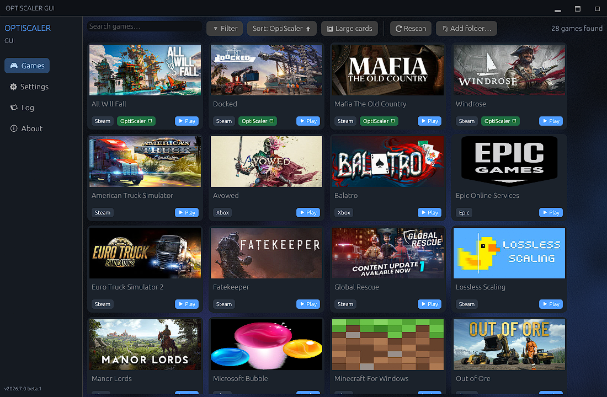
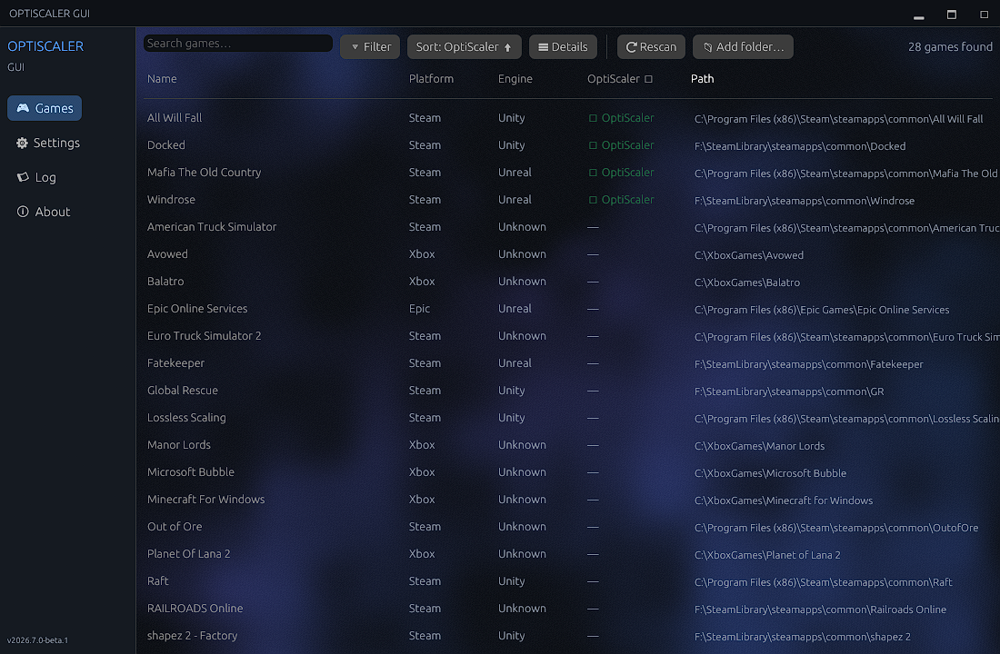

# OptiScaler GUI

[](https://github.com/King4s/OptiScaler-GUI/releases/latest)
[](https://github.com/King4s/OptiScaler-GUI/actions/workflows/ci-rust.yml)
[](LICENSE)
[](#)

**An unofficial Windows installer and manager for [OptiScaler](https://github.com/optiscaler/OptiScaler).**

All upscaling technology — FSR, XeSS, DLSS integration, frame generation, the in-game overlay — is the work of the [OptiScaler team](https://github.com/optiscaler/OptiScaler). This project does one thing: it makes installing their mod easy. It detects your games, downloads the latest official OptiScaler release, and copies the right files into the right place — no manual extraction, renaming, or INI editing.

> **This is a community project, not affiliated with or endorsed by the OptiScaler developers.**
> Support and bug reports for this tool go to [this repository's issues](https://github.com/King4s/OptiScaler-GUI/issues) only — **please don't ask the OptiScaler team about this tool.** For questions about OptiScaler itself, use the [official repository](https://github.com/optiscaler/OptiScaler).



## Features

**[2026.11.0 stable](https://github.com/King4s/OptiScaler-GUI/releases/tag/v2026.11.0)** adds wide Steam artwork, a likely-compatible game filter, verified cache repair and exact-version INI defaults.

- **One-click install, update, and uninstall** of official OptiScaler releases
- **Game discovery** for Steam, Epic Games, GOG Galaxy, Xbox Game Pass, Heroic Launcher, Amazon Games, Ubisoft Connect, EA app and Battle.net; configurable library folders can be enabled, removed and rescanned
- **Launch games directly** — with or without the OptiScaler proxy (Steam games via the Steam client, Game Pass via the bundled launch helper)
- **Reviewed install targets** — resolves the selected game executable to a target folder, shows both paths before install, and requires explicit selection when the layout is ambiguous; includes the documented Satisfactory target exception
- **Settings editor** for `OptiScaler.ini` with per-key reset and change preview (runtime tuning is still done in OptiScaler's own Insert-key overlay)
- **Transactional install management** — SHA256 verification, v2 ownership manifest, preservation of pre-existing files, and rollback/recovery snapshots
- **Local guidance and report preview** — inspect detected GPU facts and source-linked advice, then review and explicitly save a limited JSON report with your test result
- **Explorer-style library** — large/small cards, list and details views, sorting and filtering, aspect-preserving covers, local artwork selection and optional SteamGridDB matching
- **GPU-rendered UI** (egui/wgpu) with selectable animated backgrounds — and zero idle cost when disabled
- **Portable** — a native executable with nothing to install
- **Languages:** English, Danish, Polish



## 2026.10.0 hardware and runtime additions

- Worker-thread hardware collection on every startup, independent of update checks; always-visible family recommendations and manual refresh in English, Danish and Polish. Facts stay local and hardware deletion remains available.
- RX 6000 / RDNA2 can explicitly opt into the separately pinned community FSR 4.1.1b INT8 fix. Choose the game's actual rendering GPU first and accept a community/anti-cheat warning for each operation. No automatic GPU choice, patch or tuning changes.
- Separate verified cache and staged DLL validation before game mutations; atomic file replacement and manifest provenance preserve update/uninstall ownership and original-file recovery. Automatic updates refuse community installs instead of silently swapping runtimes.
- RDNA3/4 keep official FSR 4; RTX native DLSS, Arc XeSS, and older GPUs XeSS/FSR 3.1 are suggestions only where supported. Unknown/APU/mixed hardware stays conservative until explicit per-game choice.
- Legacy Python implementation, tests, requirements, PyInstaller tooling and Python CI removed; shared data/translations moved under `rust/crates/opticore/data/`. Historical release records remain history.

See the [hardware/runtime feature guide](docs/hardware-runtime.md). Hardware recommendations are advisory and do not prove gameplay compatibility.

## Getting started

1. Download [the portable EXE](https://github.com/King4s/OptiScaler-GUI/releases/download/v2026.11.0/OptiScaler-GUI.exe) or [the same EXE in a 7z archive](https://github.com/King4s/OptiScaler-GUI/releases/download/v2026.11.0/OptiScaler-GUI.7z). Extract the archive if you chose the 7z.
2. Run the EXE. No installer is needed.
3. Scan for games (or browse to a game folder manually), select a game, click **Install**
4. Launch the game and press **Insert** (**Alt+Insert** on non-US keyboard layouts) to configure upscaling in OptiScaler's overlay

Requires Windows 10/11. OptiScaler is downloaded from official GitHub releases. 2026.10.0 also offers a separately pinned, explicitly opt-in community RDNA2 FSR runtime; official OptiScaler extraction is never modified. Local hardware and install observations are used for on-device guidance. Reports are previewed in the game panel and saved only after you choose a file; review the JSON before sharing it yourself.

## OptiScaler compatibility

The library opens with **Likely compatible** enabled. This shortlist uses detected upscaler DLLs, a community report or an existing install, and excludes detected anti-cheat and unsupported engines. It is not a guarantee. Select **Show all games** to see unknown games too; the GUI remembers your choice.

The GUI downloads the latest official OptiScaler release. The previously reviewed range was **v0.7.0 through v0.9.4**. A [Windows upgrade test](https://github.com/King4s/OptiScaler-GUI/actions/runs/44971702304) also passed a real v0.9.4-to-v0.9.5 upgrade and uninstall in a disposable game folder. Both new Vulkan DLLs were installed and removed, the original proxy was restored, and a customized INI and unrelated mod were preserved. This was a file-operation test, not an in-game test.

GUI 2026.11.0 recognizes v0.9.5 initialization log evidence and its numeric INT8 settings. With v0.9.5, try the bundled FSR 4.1.2 runtime first on supported RDNA2 hardware; the older community runtime is optional.

## Project status

**2026.11.0 Standard:** see the [release notes](docs/releases/2026.11.0.md) and [verification record](docs/releases/2026.11.0-verification.md).

Fatekeeper has a working user report from 2026-09-25; fresh-version gameplay and manual visual testing are not claimed. Discovery, artwork, hardware advice and log observations do not establish compatibility with all games. A detected `Init done` line can be stale.

| Track | Where | Status |
|---|---|---|
| Rust app (CalVer `2026.x`) | `rust/` | 2026.11.0 Standard; consult [GitHub Releases](https://github.com/King4s/OptiScaler-GUI/releases) for availability. |
| Historical Python app (v0.x) | Git history / old releases only | Implementation and Python tooling removed from current source. Legacy game files/manifests remain preserved. |

## Supported discovery sources

2026.9.0 retains Steam, Epic Games, GOG Galaxy, Xbox Game Pass and Heroic discovery, and adds these local metadata adapters:

| Store | Metadata used | Limits |
|---|---|---|
| Amazon Games | Local `GameInstallInfo.sqlite` installed-game records, opened read-only | Requires installed rows with a title, product ID and existing directory. |
| Ubisoft Connect | Launcher install registry keys and `InstallDir` | Numeric store ID comes from the key; display titles can come from folder names. |
| EA app / Origin | Game registry entries with `Product GUID`, plus `__Installer/installerdata.xml` content IDs | Known library roots and registry-linked paths are covered; arbitrary EA locations or incomplete metadata may be missed. |
| Battle.net | Local Agent `product.db` product IDs and install paths | Launcher records and stale paths are excluded; display titles can come from folder names. |

These are best-effort discovery sources, not a guarantee that every installed game will appear or support OptiScaler. Missing, malformed or inaccessible metadata can produce a warning or no result. Use a specific custom library folder or manual game selection when needed. Enable/disable or remove configured roots and rescan to apply changes; removing a root does not delete games. Custom scans are bounded and reject unsafe roots. See [store format evidence](docs/store-formats.md) and [troubleshooting](docs/TROUBLESHOOTING.md).

## Cover artwork and privacy

Cards fit images without stretching. The GUI prefers Steam's local wide header for the exact app ID, tries online wide sources when needed, and keeps portraits as fallbacks. Automatic covers from older versions get one wide-first lookup; manual selections and legacy files stay untouched. The cache separates installs by platform, observed store identity and install path.

Use the artwork controls to choose a local image, reset a selection or refresh automatic artwork. Refresh preserves an explicitly selected local or SteamGridDB cover and retains the last good artwork if replacement fails. Automatic sources use local artwork and identified store/Steam sources, with cached or icon fallbacks; availability is not guaranteed. No automatic SteamSpy title matching is used to infer a Steam identity.

SteamGridDB is optional. Explicit consent and your own session-only API key are required; you choose both the matching game and the image. Lookup sends an explicit Steam app ID when available, or the game title for search; subsequent requests retrieve choices and the selected cover. Automatic cover refresh does not call SteamGridDB. Existing identified store artwork may still use network downloads. See [cover artwork details](docs/cover-art.md).

The discovery/artwork work adds no mods and changes no installer behavior. Reviewed targets, explicit EXE choice for ambiguous layouts, v2 ownership checks, rollback and preservation of legacy or foreign files remain in force. Reference repositories are format research only; their implementation code is not copied, vendored or added as a project dependency.

## Running from source

```bash
git clone https://github.com/King4s/OptiScaler-GUI.git
cd OptiScaler-GUI/rust
cargo run --release --locked
```

Run `cargo test --workspace --locked`, `cargo fmt --all --check` and `cargo clippy --workspace --all-targets --locked -- -D warnings` from `rust/`. Current source is Rust-only; no Python runtime, requirements or PyInstaller build remains. See [technical overview](docs/TECHNICAL_OVERVIEW.md) and [contributor guidance](CLAUDE.md).

## Reporting issues

- [Bug report](https://github.com/King4s/OptiScaler-GUI/issues/new?template=bug_report.md)
- [Game compatibility issue](https://github.com/King4s/OptiScaler-GUI/issues/new?template=game_compatibility.md)
- [Feature request](https://github.com/King4s/OptiScaler-GUI/issues/new?template=feature_request.md)

## Credits

- The [**OptiScaler team**](https://github.com/optiscaler/OptiScaler) — for the upscaling technology this project exists to serve. If you find OptiScaler useful, consider [supporting them](https://github.com/sponsors/cdozdil).
- OptiScaler bundles further excellent work: [fakenvapi](https://github.com/optiscaler/fakenvapi), Nukem's [dlssg-to-fsr3](https://github.com/Nukem9/dlssg-to-fsr3), AMD FidelityFX SDK, and Intel XeSS SDK.

## License

MIT — see [LICENSE](LICENSE). OptiScaler and its bundled components are licensed by their respective authors.
